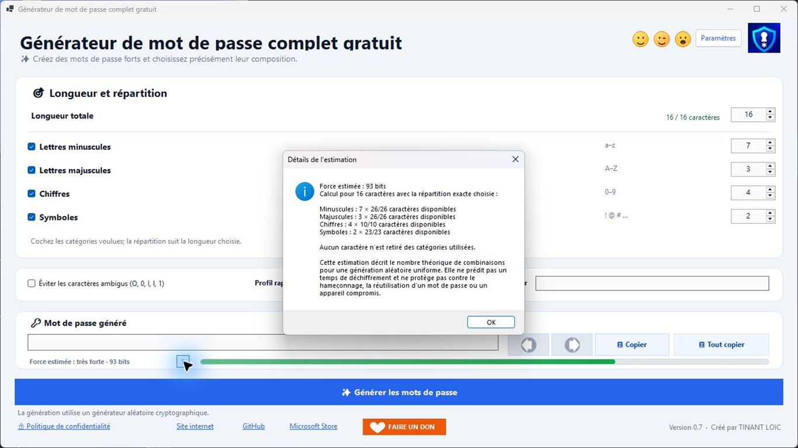
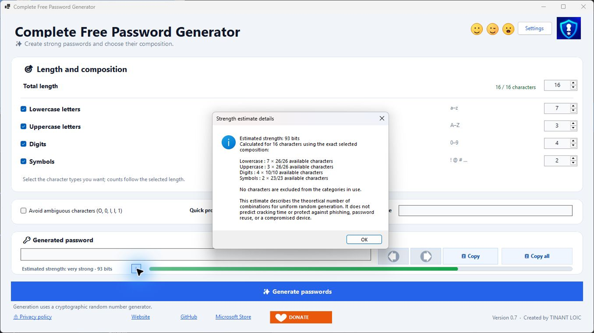

# Générateur de mot de passe complet gratuit

**Créez des mots de passe forts sur Windows, gratuitement et hors ligne.** Réglez la longueur et les catégories de caractères, puis générez un mot de passe ou un lot de résultats uniques.

## Captures d’écran — version 0.7

## Télécharger

Téléchargez **GenerateurMotDePasseCompletGratuit_0.7.exe** depuis la [dernière version publiée sur GitHub](https://github.com/loictinant/Generateur-mot-de-passe-complet-gratuit/releases/latest). Cette version autonome inclut son environnement d’exécution Windows; aucun mot de passe n’est envoyé à un service en ligne.

> L’EXE publié sur GitHub n’est pas signé par un certificat de signature de code. Windows peut afficher un avertissement SmartScreen avant le téléchargement ou le lancement. Pour installer l’application depuis le Store, consultez la [fiche Microsoft Store](https://apps.microsoft.com/detail/9p7dgl8k9zgv?hl=fr-FR&gl=FR).

Consultez l’[historique complet des versions 0.1 à 0.7](HISTORIQUE-MISES-A-JOUR-0.1-A-0.7.txt).

## Fonctionnalités

- **Choix précis de la composition :** choisissez la longueur et activez ou désactivez les minuscules, majuscules, chiffres et symboles.
- **Répartition automatique :** lorsque vous changez la longueur, la répartition s’ajuste entre les catégories actives. Vous pouvez ensuite régler chaque quantité.
- **Exclusions personnalisées :** écartez les caractères ambigus ou saisissez les caractères que vous ne voulez pas utiliser.
- **Profils rapides et personnalisés :** utilisez les profils intégrés ou enregistrez jusqu’à 20 profils avec vos réglages favoris.
- **Lots sans doublon :** générez jusqu’à 10 mots de passe uniques en une fois et parcourez les résultats.
- **Force expliquée :** l’estimation affiche les caractères réellement disponibles par catégorie et explique l’effet des caractères exclus. Elle correspond à une estimation théorique de combinaisons; elle ne prédit pas un temps de déchiffrement.
- **Effacement différé du presse-papiers :** choisissez Jamais, 15, 30 ou 60 secondes. L’application affiche le compte à rebours et ne supprime le contenu que s’il est encore identique à ce qu’elle a copié. Si Windows ou une autre application bloque l’accès, elle vous indique de vérifier le presse-papiers manuellement.
- **Français et anglais :** choisissez la langue dans Paramètres; le choix est conservé localement.
- **Thèmes clair et sombre :** adaptez l’apparence de l’application.
- **Accessibilité :** aides contextuelles, noms accessibles et navigation au clavier.
- **Interface Windows :** logo, icône, smileys en couleur, liens vers le site, GitHub, Microsoft Store et PayPal.

## Utilisation

1. Choisissez un profil rapide ou réglez la longueur et les catégories de caractères.
2. Si besoin, définissez la quantité et les caractères à éviter.
3. Cliquez sur **Générer les mots de passe**.
4. Parcourez les résultats, puis copiez un mot de passe ou l’ensemble du lot.

## Confidentialité

La génération est effectuée sur l’appareil. L’application ne crée pas de compte, ne conserve pas les mots de passe générés et ne les transmet pas à l’éditeur. La langue, le thème, le délai d’effacement et les profils personnalisés sont enregistrés localement dans le profil Windows. Les mots de passe copiés transitent par le presse-papiers Windows; l’historique ou la synchronisation du presse-papiers peut en conserver une copie selon les réglages de Windows. Pour l’effacement différé, l’application doit rester ouverte.

## Informations

- **Nom :** Générateur de mot de passe complet gratuit
- **Version :** 0.7
- **Système :** Windows 10 (version 19041 ou ultérieure) et Windows 11, x64
- **Créé par :** TINANT LOIC
- **Prix :** gratuit

[Site internet](https://loic-apps.duckdns.org/) · [GitHub](https://github.com/loictinant/Generateur-mot-de-passe-complet-gratuit) · [Microsoft Store](https://apps.microsoft.com/detail/9p7dgl8k9zgv?hl=fr-FR&gl=FR) · [Faire un don](https://www.paypal.me/loic008)
