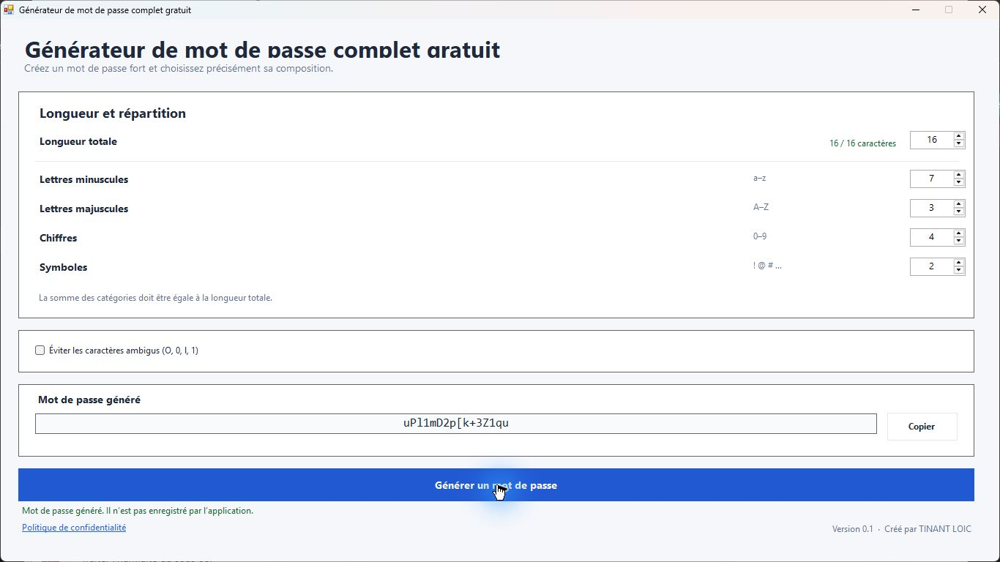

# Générateur de mot de passe complet gratuit

**Un générateur de mots de passe pour Windows, simple à régler et utilisable hors ligne.** Choisissez la longueur, définissez exactement le nombre de minuscules, de majuscules, de chiffres et de symboles, puis créez un mot de passe aléatoire directement sur votre ordinateur.

## Télécharger

La version **0.4** est disponible.

## À quoi sert ce logiciel ?

Le Générateur de mot de passe complet gratuit permet de créer des mots de passe aléatoires en gardant la maîtrise de leur composition. Au lieu de choisir seulement une longueur ou un ensemble de caractères général, vous pouvez indiquer combien de caractères de chaque catégorie doivent apparaître. Le logiciel mélange ensuite les caractères sélectionnés avant d’afficher le résultat.

L’application est conçue pour aller droit au but : ses réglages et le mot de passe sont présentés dans une seule fenêtre. Aucun compte n’est nécessaire. La génération se fait localement sur le PC et le mot de passe n’est pas enregistré par l’application.

## Fonctionnalités

- **Longueur personnalisable :** de 1 à 128 caractères.
- **Répartition précise :** choisissez le nombre exact de lettres minuscules, de lettres majuscules, de chiffres et de symboles.
- **Vérification de la longueur :** le total des catégories doit correspondre à la longueur choisie. Le bouton de génération est activé lorsque la répartition est valide.
- **Exclusion des caractères ambigus :** option pour écarter `O`, `0`, `I`, `l` et `1`, afin de rendre le résultat plus facile à lire ou à recopier.
- **Génération aléatoire cryptographique :** les caractères sont tirés avec l’API cryptographique de .NET, puis mélangés.
- **Copie en un clic :** copiez le résultat dans le presse-papiers Windows avec le bouton **Copier**.
- **Politique de confidentialité intégrée :** consultez les informations de confidentialité depuis le lien dans l’application.
- **Interface en français :** conçue pour une utilisation simple sur un ordinateur Windows.

Les symboles disponibles comprennent notamment : `! @ # $ % ^ & * ( ) - _ = + [ ] { } ; : , . ?`.

## Utilisation

1. Choisissez la longueur totale du mot de passe.
2. Répartissez cette longueur entre les minuscules, les majuscules, les chiffres et les symboles. Vous pouvez mettre une catégorie à zéro si vous ne souhaitez pas l’utiliser.
3. Vérifiez que la somme affichée correspond à la longueur demandée.
4. Activez **Éviter les caractères ambigus** si vous souhaitez exclure `O`, `0`, `I`, `l` et `1`.
5. Cliquez sur **Générer un mot de passe**. Le résultat apparaît dans le champ prévu à cet effet.
6. Cliquez sur **Copier** pour le placer dans le presse-papiers, puis collez-le dans le service concerné.

## Confidentialité et traitement des mots de passe

La génération et l’affichage du mot de passe se font sur l’appareil. L’application ne crée pas de compte, ne transmet pas le mot de passe à l’éditeur et ne le sauvegarde pas dans un fichier. Les choix de composition ne sont pas conservés après la fermeture du logiciel.

Lorsque vous cliquez sur **Copier**, le mot de passe est écrit dans le presse-papiers Windows. Windows peut conserver ou synchroniser le contenu du presse-papiers selon les paramètres de votre appareil. Pensez à remplacer ou effacer ce contenu lorsque vous avez terminé, en particulier sur un ordinateur partagé.

Le logiciel est un générateur et ne conserve pas vos mots de passe : enregistrez le mot de passe obtenu dans un coffre-fort adapté si vous devez le retrouver plus tard.

## Informations

- **Nom :** Générateur de mot de passe complet gratuit
- **Version :** 0.1
- **Système :** Windows
- **Éditeur :** TINANT LOIC
- **Prix :** gratuit

## Auteur

Créé et publié par **TINANT LOIC**. Pour obtenir l’exécutable ou consulter les autres versions, rendez-vous sur la [page des releases GitHub](https://github.com/loictinant/Generateur-mot-de-passe-complet-gratuit/releases).

