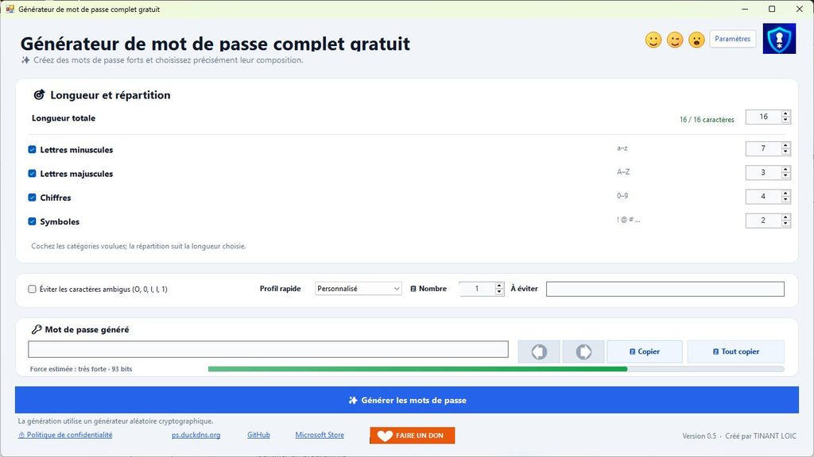

# Générateur de mot de passe complet gratuit

**Un générateur de mots de passe pour Windows, simple à régler et utilisable hors ligne.** Choisissez la longueur, la composition et le nombre de résultats à créer. Les mots de passe sont générés directement sur votre ordinateur.

## Télécharger

La version **0.5** est disponible sur la [page des releases GitHub](https://github.com/loictinant/Generateur-mot-de-passe-complet-gratuit/releases/latest). Téléchargez **GenerateurMotDePasseCompletGratuit_0.5.exe** dans la section des fichiers.

> **À propos de la signature :** cet EXE n’est pas signé par un certificat de signature de code. Windows peut afficher un avertissement SmartScreen lors du téléchargement ou du lancement. Le fichier officiel est publié dans les releases de ce dépôt.

Consultez l’[historique complet des versions 0.1 à 0.5](HISTORIQUE-MISES-A-JOUR-0.1-A-0.5.txt).

## Fonctionnalités

- **Composition personnalisée :** choisissez la longueur et activez ou désactivez les minuscules, majuscules, chiffres et symboles.
- **Répartition automatique :** les catégories actives se rééquilibrent avec la longueur sélectionnée; vous pouvez ensuite ajuster leur répartition.
- **Profils rapides :** Équilibré, Long (24 caractères) et Sans symboles.
- **Lots de mots de passe :** générez jusqu’à 10 résultats et parcourez-les avec les boutons précédent et suivant.
- **Résultats sans doublon :** chaque mot de passe d’un lot est unique. Si les réglages ne permettent pas d’atteindre la quantité demandée, l’application affiche le nombre distinct disponible.
- **Exclusions personnalisées :** évitez les caractères ambigus ou indiquez vos propres caractères à exclure.
- **Indicateur de force :** consultez une estimation indicative avec une barre colorée.
- **Copie du résultat :** copiez un mot de passe ou l’ensemble du lot dans le presse-papiers Windows.
- **Effacement différé :** dans Paramètres, choisissez de ne jamais effacer le presse-papiers ou de le vider après 15, 30 ou 60 secondes. L’application l’efface seulement si le texte copié est toujours présent et si elle est encore ouverte.
- **Thèmes clair et sombre :** le thème et le délai d’effacement choisi sont conservés localement dans votre profil Windows.
- **Accessibilité :** noms accessibles, aides contextuelles et navigation au clavier.

La génération utilise le générateur aléatoire cryptographique de .NET. Les mots de passe générés restent uniquement en mémoire et ne sont pas enregistrés dans un fichier.

## Utilisation

1. Choisissez un profil rapide ou réglez la longueur et les catégories de caractères.
2. Indiquez le nombre de mots de passe à générer et, si besoin, les caractères à éviter.
3. Cliquez sur **Générer les mots de passe**.
4. Parcourez les résultats, puis copiez le mot de passe affiché ou tout le lot.

## Confidentialité

La génération se fait sur l’appareil. L’application ne crée pas de compte, n’enregistre pas les mots de passe et ne les transmet pas à l’éditeur. Seuls le thème et le délai d’effacement sont conservés dans le profil Windows. L’effacement du presse-papiers ne supprime pas nécessairement les copies déjà conservées ou synchronisées par Windows selon ses propres réglages.

## Informations

- **Nom :** Générateur de mot de passe complet gratuit
- **Version :** 0.5
- **Système :** Windows
- **Créé par :** TINANT LOIC
- **Prix :** gratuit

Site : [loic-apps.duckdns.org](https://loic-apps.duckdns.org/) · [GitHub](https://github.com/loictinant/Generateur-mot-de-passe-complet-gratuit) · [Microsoft Store](https://apps.microsoft.com/detail/9p7dgl8k9zgv?hl=fr-FR&gl=FR)
